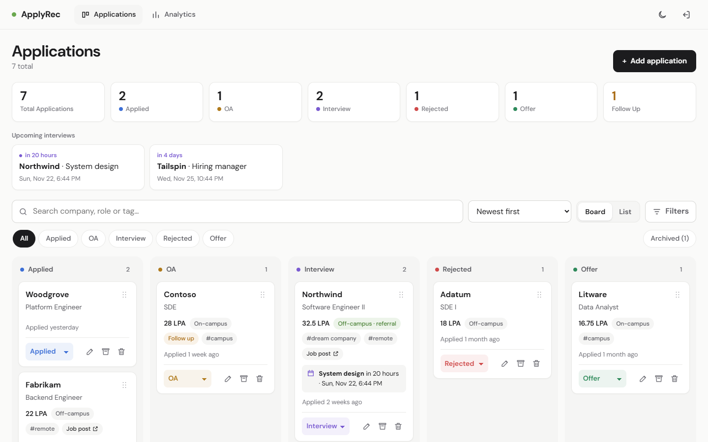
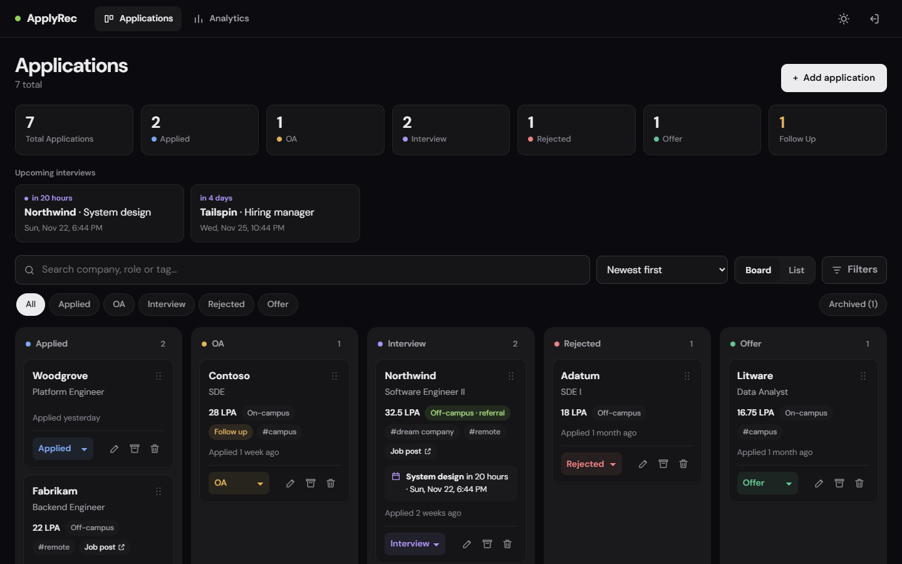
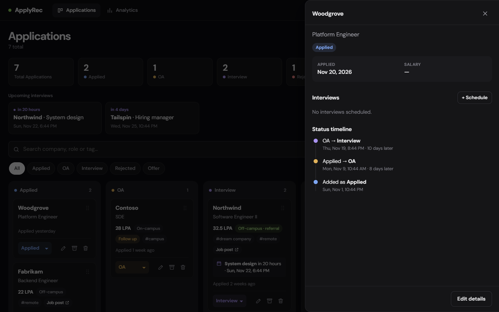
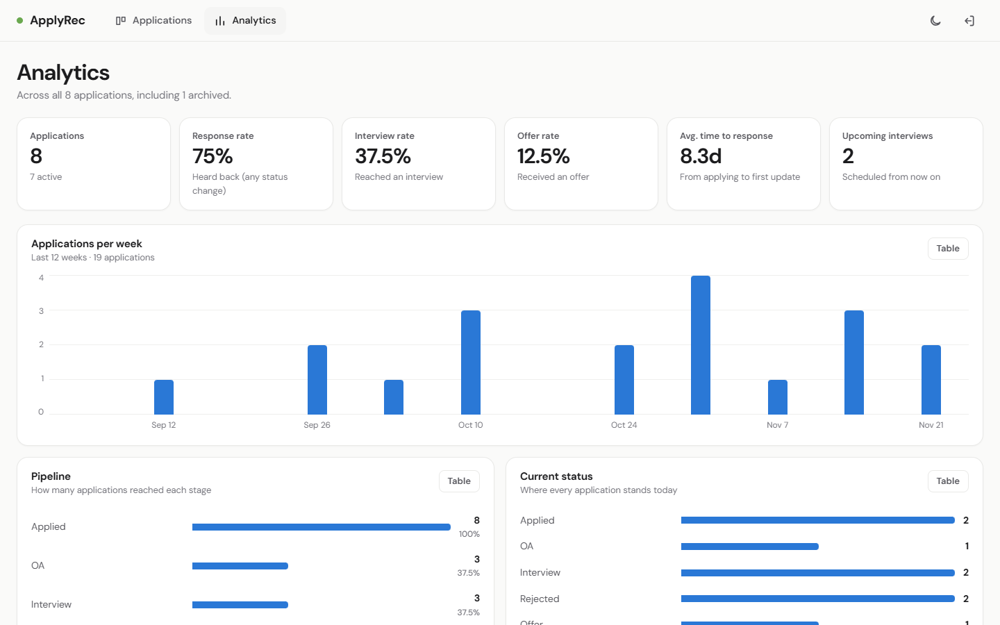
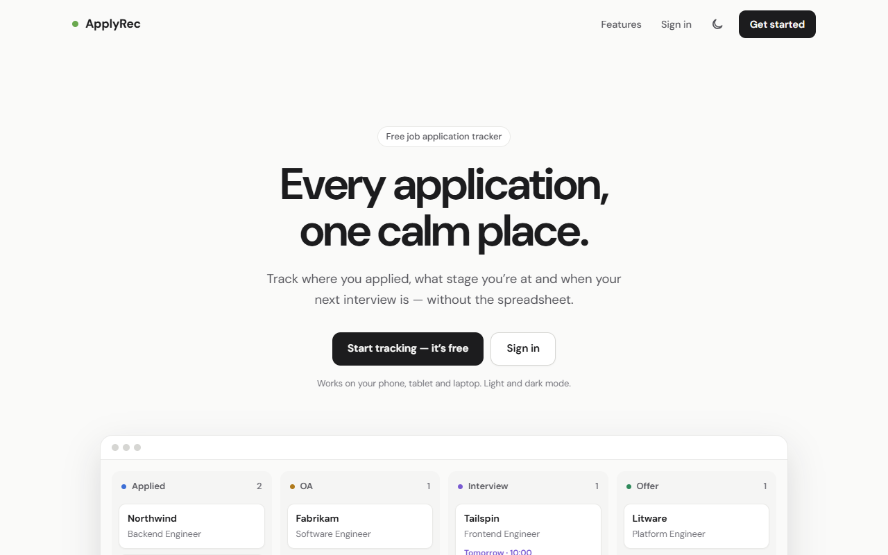
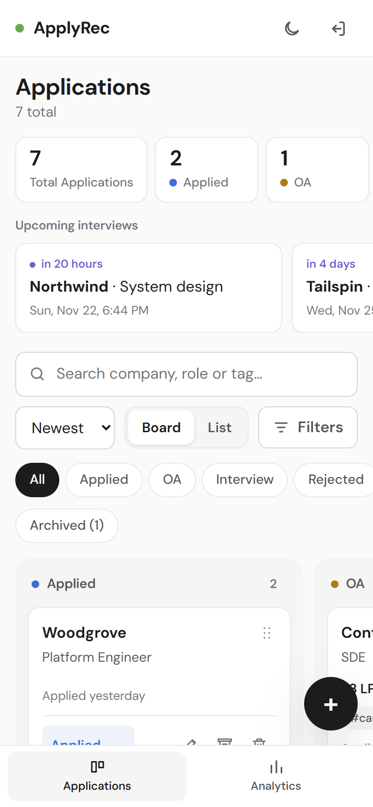
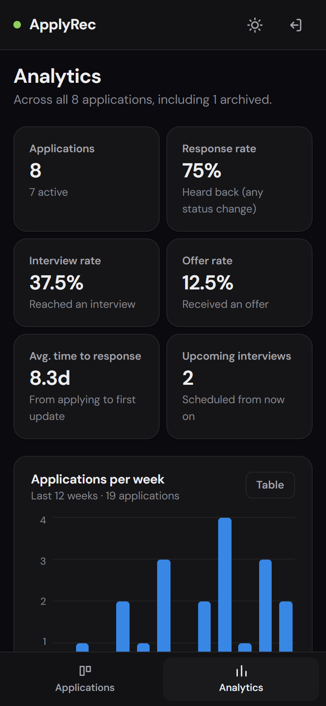

<div align="center">

# ApplyRec

**Every job application, one calm place.**

A free, full-stack tracker for students and early-career job seekers: a Kanban board for your
pipeline, interview reminders, and analytics that show what's actually working.

[**Live app →**](https://apply-rec.vercel.app)



</div>

---

## Contents

- [Features](#features)
- [Screenshots](#screenshots)
- [Tech stack](#tech-stack)
- [Run it locally](#run-it-locally)
- [Testing](#testing)
- [Configuration](#configuration)
- [API](#api)
- [Deployment](#deployment)
- [Project structure](#project-structure)

## Features

**Tracking**
- **Board and list views.** Drag cards between stages with a mouse, a finger (long-press) or the keyboard, or pick a status from the card menu.
- **Rich applications.** Job posting link, on- or off-campus, referral, tags, salary (LPA), notes and a follow-up flag.
- **Interviews.** Schedule every round; an email reminder goes out about 24 hours before.
- **Status timeline.** Every status change is recorded per application.
- **Archive and undo.** Archive old applications to keep the board focused; delete and archive both have a 5-second Undo.
- **Search and filters.** Search company, role or tag; filter by status, role, tag, source and salary; sort several ways.

**Insights**
- **Analytics.** Response, interview and offer rates, average time to first response, applications per week, the pipeline, and interview rate by source (on-campus vs. referral vs. none) and by tag.

**Experience**
- **Responsive** on phones, tablets and laptops, with a bottom tab bar on phones.
- **Light and dark theme** that follows your system until you choose.
- **Accessible.** Keyboard-friendly drag-and-drop, focus-trapped dialogs, labelled controls, and a table view for every chart.
- **Cold-start friendly.** A "waking up the server" banner, automatic retries and a warm-up ping for free hosting.

**Accounts and security**
- JWT sign-up and login, forgot/reset password by email (single-use links that expire in 30 minutes), and rate-limited login.

## Screenshots

| Dark mode | Application details |
|---|---|
|  |  |

| Analytics | Landing page |
|---|---|
|  |  |

<p align="center">
  
  &nbsp;&nbsp;
  
</p>

## Tech stack

| Layer | Technology |
|---|---|
| Frontend | React 18, React Router 7, TanStack Query 5, dnd-kit, Vite 6, CSS Modules |
| Backend | Spring Boot 3.2, Java 17, Spring Security (stateless JWT) |
| Database | PostgreSQL with Flyway migrations |
| Email | Resend HTTP API (optional) |
| Tests | JUnit 5, MockMvc, embedded PostgreSQL; Vitest, Testing Library |
| Hosting | Vercel (frontend), Render via Docker (backend), Neon (database) |

## Run it locally

**Requirements:** Java 17+, Node.js 20+ and a PostgreSQL database (local or hosted).
Maven is not needed; use the bundled `./mvnw` (`mvnw.cmd` on Windows).

**Backend** (runs on `http://localhost:8080`):

```bash
cd Backend
export SPRING_DATASOURCE_URL='jdbc:postgresql://localhost:5432/applyrec'
export SPRING_DATASOURCE_USERNAME='postgres'
export SPRING_DATASOURCE_PASSWORD='postgres'
export JWT_SECRET="$(openssl rand -base64 48)"   # at least 32 bytes
export SPRING_PROFILES_ACTIVE=dev
export APP_DEV_SEED_ENABLED=true                  # optional: demo account in an EMPTY database
./mvnw spring-boot:run
```

In PowerShell, set variables with `$env:JWT_SECRET = "..."` and run `.\mvnw.cmd spring-boot:run`.
With the `dev` profile and no email key, emails (including reset links) are printed to the console.

**Frontend** (runs on `http://localhost:3000`):

```bash
cd Frontend
npm install
npm run dev        # uses http://localhost:8080/api unless VITE_API_URL is set
```

## Testing

```bash
cd Backend && ./mvnw test    # unit, MockMvc and integration tests
cd Frontend && npm test      # Vitest + Testing Library
```

The backend integration tests (`*IT`) start an embedded PostgreSQL 18 that Maven downloads once.
They need no Docker or local database and never connect to a real one.

## Configuration

### Backend

| Variable | Required | Description |
|---|---|---|
| `SPRING_DATASOURCE_URL` | Yes | JDBC URL, e.g. `jdbc:postgresql://host/db?sslmode=require` (not `postgres://…`) |
| `SPRING_DATASOURCE_USERNAME` | Yes | Database user |
| `SPRING_DATASOURCE_PASSWORD` | Yes | Database password |
| `JWT_SECRET` | Yes | At least 32 bytes. Generate with `openssl rand -base64 48` |
| `APP_CORS_ALLOWED_ORIGINS` | In production | Comma-separated frontend origins, e.g. `https://apply-rec.vercel.app` |
| `APP_FRONTEND_URL` | For email | Public frontend URL used in email links |
| `RESEND_API_KEY` | No | Turns on email (password reset, interview reminders) |
| `MAIL_FROM` | No | Sender, e.g. `ApplyRec <noreply@yourdomain.com>` (default `onboarding@resend.dev`) |
| `SPRING_PROFILES_ACTIVE` | No | `prod` in the Docker image, `dev` locally |
| `APP_DEV_SEED_ENABLED` | No | `true` seeds a demo account; only honoured with the `dev` profile |
| `DB_POOL_SIZE` | No | Max database connections in `prod` (default `5`) |
| `APP_REMINDER_INTERVAL_MS` | No | How often reminders are checked (default 10 minutes) |
| `PORT` | No | HTTP port (default `8080`; Render sets it) |

### Frontend

| Variable | Description |
|---|---|
| `VITE_API_URL` | Backend URL including `/api`. Applied at build time, so redeploy after changing it. |

## API

All endpoints except `/api/health` and `/api/auth/*` need `Authorization: Bearer <token>`.
Errors are always JSON: `{"error": "message"}`.

| Method | Endpoint | Description |
|---|---|---|
| `GET` | `/api/health` | Health check |
| `POST` | `/api/auth/signup` | Create an account → token |
| `POST` | `/api/auth/login` | Sign in → token (5 failed attempts per email in 15 min → `429`) |
| `POST` | `/api/auth/forgot-password` | Email a reset link (same reply whether or not the account exists) |
| `POST` | `/api/auth/reset-password` | Set a new password with the emailed token |
| `GET` | `/api/applications` | List applications |
| `POST` | `/api/applications` | Create an application |
| `GET` | `/api/applications/{id}` | Get one |
| `PUT` | `/api/applications/{id}` | Update |
| `PATCH` | `/api/applications/{id}/status` | Change status |
| `PATCH` | `/api/applications/{id}/archive` | Archive or restore |
| `DELETE` | `/api/applications/{id}` | Delete |
| `GET` | `/api/applications/{id}/history` | Status timeline |
| `POST` | `/api/applications/{id}/interviews` | Schedule an interview |
| `PUT` | `/api/applications/{id}/interviews/{interviewId}` | Update an interview |
| `DELETE` | `/api/applications/{id}/interviews/{interviewId}` | Remove an interview |
| `GET` | `/api/applications/roles` | Distinct roles |
| `GET` | `/api/analytics` | Rates, pipeline, weekly counts, breakdown by source and tag |

Salary is in LPA (0–9999.99). `openingType` is `ON_CAMPUS` or `OFF_CAMPUS`; `referral` is only kept for
off-campus openings; up to 10 `tags` of 30 characters each.

## Deployment

1. **Database.** Create a PostgreSQL database (for example on Neon). Convert its `postgres://` URL to
   `jdbc:postgresql://host/db?sslmode=require` and pass the user and password separately.
   Flyway creates and upgrades the schema on startup.
2. **Backend on Render.** New Web Service → this repo → Root Directory `Backend`, runtime Docker,
   health check `/api/health`. Set the database variables, `JWT_SECRET`, `APP_CORS_ALLOWED_ORIGINS`
   and `APP_FRONTEND_URL`.
3. **Frontend on Vercel.** Import the repo → Root Directory `Frontend` → set
   `VITE_API_URL=https://<your-service>.onrender.com/api` → deploy.
4. **Email (optional).** Create a [Resend](https://resend.com) API key and set `RESEND_API_KEY` and
   `MAIL_FROM`. Until you verify a domain, Resend only delivers to your own account's address.
5. **Keep it awake (optional).** `.github/workflows/keep-alive.yml` pings the backend every 10 minutes
   so Render's free plan doesn't sleep and reminders go out on time. Set a `BACKEND_URL` repository
   variable to point it elsewhere, or disable the workflow.

Any Docker host works too: `docker build -t applyrec-api Backend`, then run it with the variables above.

## Project structure

```
ApplyRec/
├── Backend/                     Spring Boot API
│   ├── src/main/java/com/applyrec/
│   │   ├── config/              Security, CORS, mail, scheduling
│   │   ├── controller/          REST endpoints
│   │   ├── dto/                 Request and response records
│   │   ├── entity/              JPA entities
│   │   ├── exception/           Typed errors and the JSON error handler
│   │   ├── mail/                Email senders (Resend, console)
│   │   ├── repository/          Spring Data repositories
│   │   ├── security/            JWT filter and rate limiter
│   │   └── service/             Business logic, analytics, reminders
│   ├── src/main/resources/db/migration/   Flyway migrations
│   └── Dockerfile
├── Frontend/                    React app (Vite)
│   └── src/
│       ├── components/          UI components and charts
│       ├── hooks/               Data and theme hooks
│       ├── pages/               Landing, auth, dashboard, analytics
│       ├── services/            API client
│       └── utils/               Dates, filtering, validation
├── docs/screenshots/            Images used in this README
└── .github/workflows/           Keep-alive ping
```
